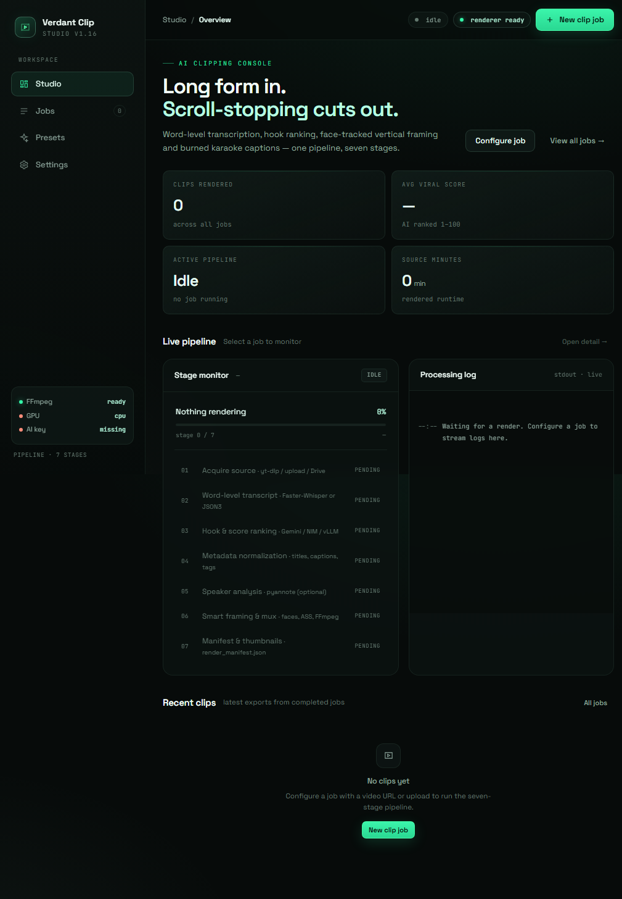
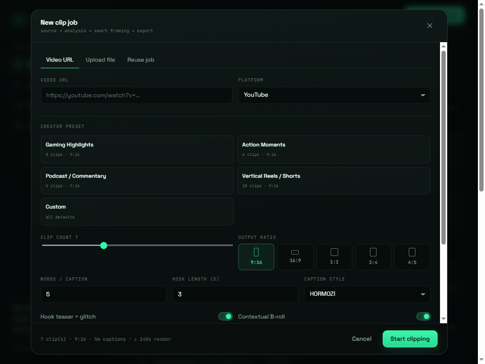

# Verdant Clip Studio

AI auto-clipper: long-form video in, scroll-stopping short-form cuts out. FastAPI job
queue + Whisper transcription + AI hook ranking + face-tracked vertical framing +
burned karaoke captions + FFmpeg muxing, with a greenish-white neon Studio UI.

The backend behavior, CLI surface, job payloads, provider routing and environment
contract follow the reference repository
[`NaufalRizqullah/opensource-clipping`](https://github.com/NaufalRizqullah/opensource-clipping)
(MIT). The frontend, presets and visual system are new.

---

## 1. Repository extraction summary

### Pipeline stages (shared by CLI and Studio)

| # | Stage | Module | Behavior |
|---|-------|--------|----------|
| 1 | Acquire source | `clipping/engine.py` | `yt-dlp` with AV1-excluding format selectors, source-height cap, browser/cookies-file support, optional JSON3 subtitle download; Google Drive via `gdown`; local uploads skip download |
| 2 | Transcribe | `clipping/engine.py` | Faster-Whisper word timestamps (`beam_size=5`), words grouped into N-word karaoke segments; YouTube JSON3 fallback cleans HTML/annotations and synthesizes word timings |
| 3 | AI curation | `clipping/engine.py`, `clipping/providers/*` | Gemini (`google-genai`, v1beta, 10 attempts, 60s+30s backoff, status-code retry filter, fallback model), NVIDIA NIM (`guided_json`), or self-hosted vLLM (`/v1/models` + `/tokenize` preflight, JSON-schema response, 3 repair attempts, no cloud fallback) |
| 4 | Metadata | `clipping/metadata.py` | Flatten nested metadata, alias fields, trim titles, normalize 2–3 hashtags and 5–8 keywords, build YouTube/TikTok EN+ID fields, QA warnings, sort by viral score, reassign ranks |
| 5 | Speaker analysis | `clipping/diarization.py` | Optional pyannote 3.1 with `HF_TOKEN`; audio extraction; auto speaker bounds from sampled face counts; failure falls back instead of aborting |
| 6 | Prepare + render | `clipping/studio/*` | Encoder detection (NVENC → libx264 fallback), generated glitch transition, custom hook resolution, B-roll download, frame-by-frame smart crop with deadzone/smoothing/snap, Hook V2 micro-hooks + flashes, keep-segment trimming, ASS karaoke, BGM ducking, concat, watermark, thumbnail |
| 7 | Manifest | `clipping/runner.py`, `web/api/worker.py` | `gemini_response.json`, `metadata_preview.json`, `ai_run_meta.json`, `render_manifest.json`, per-clip MP4 + JPG thumbnails |

### Modules

```
main.py                       CLI (batch + single URL, banner, cleanup)
clipping/config.py            defaults, font presets, full argparse surface
clipping/prompt.py            shared analysis prompt + strict JSON contract
clipping/engine.py            download, JSON3 parsing, Whisper, AI dispatch/retry
clipping/metadata.py          metadata normalization + QA
clipping/runner.py            pipeline orchestrator
clipping/presets.py           creator presets (new)
clipping/hook_manager.py      custom hook (local / Drive)
clipping/diarization.py       pyannote 3.1
clipping/voiceover.py         Gemini/vLLM script + edge-tts
clipping/providers/           gemini, nvidia, vllm, schema, validation, parsing
clipping/studio/              ffmpeg utils, face tracking, crop, ASS, BGM,
                              B-roll, effects, watermark, thumbnail, core
web/api/                      FastAPI app, models, store, worker, config bridge,
                              readiness, job/file/settings routes
web/frontend/                 Studio SPA (static, no build step)
assets/bgm/                   local BGM pool by mood (bring your own tracks)
```

### API surface

| Method | Path | Purpose |
|--------|------|---------|
| `POST` | `/api/jobs` | Create job (`url`, `upload_filename`, or `reuse_job_id`) |
| `GET` | `/api/jobs` | List jobs, newest first |
| `GET` | `/api/jobs/{id}` | Job detail (status, progress, clips, log) |
| `GET` | `/api/jobs/{id}/status` | SSE progress stream; terminal event carries clips |
| `DELETE` | `/api/jobs/{id}` | Cooperative cancel, or delete a terminal job |
| `POST` | `/api/upload` | Streamed upload, 2 GB cap, extension allowlist |
| `GET` | `/api/outputs/{id}` | List output files |
| `GET` | `/api/outputs/{id}/{file}` | Serve a clip/thumbnail/metadata file |
| `GET`/`PUT` | `/api/settings` | Masked keys + defaults (session memory) |
| `GET` | `/api/health` | Liveness, GPU/FFmpeg, queue counters |
| `GET` | `/api/ready` | Renderer readiness (503 when deps missing) |
| `GET` | `/api/meta` | Presets, ratios, font styles, providers, readiness |

Job config, response models, SSE event shape and error codes match the reference
(409 for active reuse, 400 for invalid path/source combinations, 503 before paid AI
work if the renderer is broken).

---

## 2. Environment variables

The complete, commented list is in [`.env.example`](.env.example). Summary:

| Variable | Required | Used for |
|----------|----------|----------|
| `GOOGLE_API_KEY` | yes (Gemini/voiceover) | Gemini analysis and commentary scripts |
| `NVIDIA_API_KEY` | for `--ai-provider nvidia` | NVIDIA NIM analysis |
| `PEXELS_API_KEY` | optional | Contextual B-roll |
| `HF_TOKEN` | optional | pyannote diarization (podcast modes) |
| `VLLM_BASE_URL` | optional | Self-hosted vLLM root |
| `VLLM_MODEL` | optional | Served model/alias |
| `VLLM_API_KEY` | optional | vLLM bearer token |
| `VLLM_MAX_TOKENS` | optional | Output budget (default 4096) |
| `VLLM_CONTEXT_LIMIT` | optional | Client context ceiling |
| `VLLM_TIMEOUT` | optional | Budget in seconds (default 900) |
| `MAX_CONCURRENT_JOBS` | optional | Must remain `1` (shared scratch files) |
| `OSC_JOB_STORE_PATH` | optional | Job snapshot location |
| `OSC_YOUTUBE_COOKIES_FILE` | optional | Operator cookies for yt-dlp |
| `TORCH_HOME`, `XDG_CACHE_HOME` | optional | Model/cache locations |
| `META_PAGE_ID`, `META_PAGE_ACCESS_TOKEN`, `META_GRAPH_VERSION`, `APP_TIMEZONE` | optional | Facebook Reels helper |
| `NGROK_AUTHTOKEN` | optional | Remote-GPU tunnel helper |

**Security:** only `.env.example` is tracked. `.env` is git-ignored. Nothing under
`web/` derives secrets from request payloads; the vLLM endpoint/key are
operator-only. The reference repo's `.env.sample` contains placeholders — if you
ever filled those in and committed the file, rotate the keys and move them to
`.env`.

---

## 3. Setup

### Requirements

- Python 3.10–3.12
- **FFmpeg and ffprobe on `PATH`**
- GPU + CUDA recommended for Whisper; CPU works (`--whisper-device cpu --whisper-compute-type int8`)
- A Gemini API key (default), or NVIDIA NIM, or a running vLLM server

```bash
python -m venv .venv && source .venv/bin/activate
pip install -r requirements.txt          # full pipeline (GPU/Whisper/diarization)
# or
pip install -r requirements-lite.txt     # Studio + renderer, no Whisper/pyannote
cp .env.example .env                      # add GOOGLE_API_KEY
```

Fonts are downloaded on first render into `custom_fonts/` (Montserrat, Anton, Inter,
Lora, Roboto, Bebas Neue). Add royalty-free tracks to `assets/bgm/<mood>/`; clips
render without BGM if the pool is empty.

### Run the Studio

```bash
uvicorn web.api.app:app --host 0.0.0.0 --port 8000
# open http://localhost:8000
```

Studio shows: job dashboard, live 7-stage monitor with SSE logs, clip grid with
preview and metadata copy/export, creator presets, and readiness/settings.

### Run the CLI

```bash
python main.py --url "https://youtube.com/watch?v=VIDEO_ID"
python main.py --url URL1 URL2 --clips 3 --ratio 9:16 --cleanup-source
python main.py --url URL --clips 5 --hook-v2 --camera-switch
python main.py --url URL --ai-provider vllm --whisper-device cpu --whisper-compute-type int8
python main.py --help
```

### Docker

```bash
docker compose up --build      # http://localhost:8000
```

---

## 4. Creator presets

| Preset | Output |
|--------|--------|
| Gaming Highlights | 8 clips, 9:16, 4-word captions, 2s hook + Hook V2, no B-roll, ducked BGM, CRF 18 |
| Action Moments | 6 clips, 3-word captions, glitch hook, B-roll, cinematic font, CRF 17 |
| Podcast / Commentary | 5 clips, 7-word captions, camera switch, background BGM, storyteller font |
| Vertical Reels / Shorts | 10 clips, 9:16 1080, Hook V2, B-roll, ducked BGM, `reel_{rank}_{slug}_{date}.mp4` |

Presets only set existing pipeline parameters; every value remains editable per job.
Output naming accepts `{rank}`, `{slug}`, `{date}`.

---

## 5. Parity notes

Implemented to match the reference: ingestion paths and format selectors, Whisper
word chunking, AI prompts/rules/JSON contract, Gemini retry/fallback policy, NVIDIA
guided JSON, vLLM preflight/schema validation, metadata QA, job store/SSE statuses,
readiness gating, ASS karaoke timing, face-tracked crop with the documented
smoothing knobs, keep-segment trimming, Hook V2, BGM ducking, B-roll overlay,
watermark and thumbnail generation, manifest fields.

Deliberate differences / limitations:

- **Intermediates are MP4, concatenated with the concat demuxer** instead of
  MPEG-TS. The reference uses TS; the static FFmpeg build used for verification
  segfaults decoding TS, so MP4 intermediates are safer while keeping the same
  codecs and stage order.
- **Podcast split-screen and camera-switch composition** are not reimplemented:
  diarization still runs (when enabled and `HF_TOKEN` is set) and feeds the job,
  but `proses_klip` renders the tracked full-frame crop. Treat those two flags as
  data-only for now.
- **Voice-over** generates a script and TTS audio, but the freeze-frame/glow
  intro compositor from the reference is not rebuilt; the rendered clip does not
  include the VO intro.
- **YOLO face tracking** is not bundled; MediaPipe BlazeFace is used when installed,
  with an OpenCV Haar fallback. `--face-detector yolo` falls back to that path.
- BGM tracks, YouTube/Facebook uploaders, Kaggle/Colab notebooks and the remote GPU
  scripts from the reference repo are not included.

---

## 6. Studio frontend

The Studio is a static SPA served by FastAPI at `/` — no npm, no build step, no
bundler. It talks to the same API the CLI uses.

- **Dashboard** — renderer/GPU/AI-key readiness pills, clips rendered, average
  viral score, active pipeline, source minutes, stage monitor and live processing
  log over SSE.
- **Composer** — source tabs (URL / upload / reuse), platform, creator presets,
  clip count, ratio, captions per line, hook length, caption style, Hook V2,
  B-roll, karaoke, smart trim, BGM, batch filename pattern, advanced pipeline
  settings (provider, model, encoder, CRF, watermark, Whisper, diarization).
- **Clips** — 9:16 cards with inline preview, viral score, hook/title/description,
  hashtags, keywords, copy-metadata and download actions.
- **Design system** — background `#070B0A`, panels `#0D1412`, cards `#111C19`,
  glass `blur(12px)`, hairline `rgba(167,255,220,0.14)`, mint `#34F5A8` /
  `#52FFA8`, greenish-white `#E6FFF5` / `#B8FFE3`, sage `#8FA89E`, off-white
  `#F2FFF9`; Space Grotesk + JetBrains Mono; glow used only for state and focus.





---

## 7. Build the final app (original prompt)

Use the repository as the reference implementation, or paste this brief into a
coding agent to reproduce/extend it. It is the original build instruction.

> **Prompt — Verdant Clip Studio**
>
> Build a full-stack AI video clipper called **Verdant Clip Studio** that turns a
> long video URL or upload into ranked vertical clips with burned captions.
>
> **Stack:** Python 3.10–3.12, FastAPI, vanilla-JS static SPA (no build step),
> FFmpeg/ffprobe on `PATH`, Faster-Whisper, yt-dlp/gdown, NumPy/OpenCV/Pillow.
> JSON file store, one job at a time, SSE progress.
>
> **Pipeline:** acquire (YouTube/TikTok/Instagram/Drive/upload) → transcribe
> (Whisper word timestamps, JSON3 fallback) → AI curation (Gemini default,
> NVIDIA NIM, or self-hosted vLLM; strict clip JSON, 20–179 s clips, viral score,
> hook/description/hashtags/keywords) → metadata normalization and QA → optional
> pyannote diarization → render (encoder detection, face-tracked 9:16 crop,
> blurred-backdrop fallback, Hook V2, keep-segment trim, ASS karaoke burn-in, BGM
> ducking, B-roll, watermark, thumbnails) → manifest.
>
> **API:** `POST/GET/DELETE /api/jobs`, SSE `/api/jobs/{id}/status`, `/api/upload`
> (2 GB), `/api/outputs/...`, `/api/settings`, `/api/health`, `/api/ready`,
> `/api/meta`. Preserve status codes and job states.
>
> **Config:** every key from environment only, documented in `.env.example`;
> never hardcode secrets; mask keys in settings responses.
>
> **Presets:** Gaming Highlights, Action Moments, Podcast/Commentary, Vertical
> Reels/Shorts — tunable clip count, length, hook sensitivity, caption style and
> batch naming (`{rank}`, `{slug}`, `{date}`).
>
> **Design:** dark obsidian `#070B0A`, mint `#34F5A8`, greenish-white text, glass
> panels, Space Grotesk + JetBrains Mono, restrained glow, scannable clip cards,
> live log, instant preview/export.
>
> **Deliverables:** runnable code, `.env.example`, setup guide, parity notes.

### From clone to running app

```bash
git clone https://github.com/DHSDevelopers/verdant-clip-studio.git
cd verdant-clip-studio
python -m venv .venv && source .venv/bin/activate
pip install -r requirements.txt
cp .env.example .env        # add GOOGLE_API_KEY
uvicorn web.api.app:app --host 0.0.0.0 --port 8000
```

Open `http://localhost:8000`, pick a preset, paste a URL and start clipping. For
the CLI use `python main.py --url "..."`. Where to extend: `clipping/studio/` for
render/composition, `clipping/providers/` for a new model provider,
`web/api/routes/` for endpoints and `web/frontend/assets/` for UI.

The GitHub Pages site for this repository renders this README only; the Studio
and pipeline require a Python host with FFmpeg (local, Docker, or a VM).

---

## 8. Attribution

Backend architecture and pipeline behavior are derived from
`NaufalRizqullah/opensource-clipping` (MIT). All code in this repository is an
independent implementation with a new UI and preset layer.
